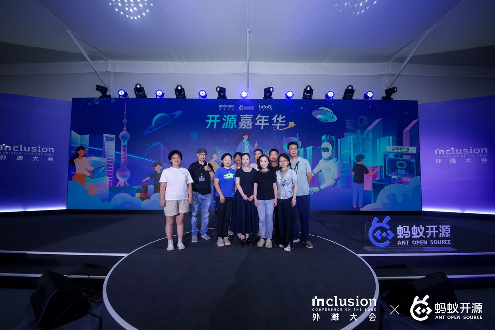

[简体中文](README.md) | [English](README.en.md) | [Русский](README.ru.md) | [Español](README.es.md) | [日本語](README.ja.md) | [한국어](README.ko.md)

# 🔥 [Сообщество OpenCare](https://info.xiao-x-bao.com.cn) и PancrePal: Освещаем надежду для больных раком, редкими и хроническими заболеваниями с помощью ИИ ✨

**Общественный проект с открытым исходным кодом от Tiangong Kaiwu (<www.xiaoyibao.com.cn>) | Подписывайтесь на наши официальные аккаунты в WeChat: 【小胰宝】 (PancrePal) и 【小胰宝助手】 (PancrePal Assistant) для получения последних обновлений.**

Мы глубоко верим, что код — это не просто холодные символы, а мост, соединяющий разработчиков и пациентов — теплая сила, которая защищает жизнь с помощью технологий.

---

## 🎯 Два пути присоединения к сообществу

> **Код — это мост, исследование — это маяк.** Будь вы разработчик или исследователь, вы можете одной фразой упаковать свои возможности в AI-агента и вместе с нами зажечь свет надежды для пациентов с раком, редкими и хроническими заболеваниями ✨
>
> 🚦 **Не хотите читать длинную версию?** Переходите сразу к **[📋 Доске задач сообщества · Project →](https://github.com/orgs/PancrePal-xiaoyibao/projects/4)** и берите на себя веху, или откройте **[🌟 BillBoard видения 2026 #24 →](https://github.com/PancrePal-xiaoyibao/.github/issues/24)**, чтобы увидеть масштаб того, что строит это сообщество.

<table>
<tr>
<td align="center" width="50%" valign="top">

### 🔨 [CodeForge](https://github.com/PancrePal-xiaoyibao/CodeForge)

**Вход для разработчиков**

Движок сообщества для open source-вкладов · Community Contribution Engine

AI-каркас для новичков в open source. Он упаковывает **16 навыков разработки + движок deep-research** в набор инструментов, разворачиваемый одной фразой.

> **Увидели issue → развернули CodeForge одной фразой → агент закрыл задачу → открыли PR**

**Это для вас, если:**
- 🌱 Вы хотите сделать первый open source-вклад (**15 минут, всё в браузере**)
- 💻 Вы уже разработчик и хотите ускорить проекты сообщества с помощью ИИ
- 🇨🇳 Вы хотите использовать китайские LLM (GLM-5.2 / DeepSeek / Kimi / MiMo — всё поддерживается)
- 🚀 Вы хотите передать свой код сообществу — туда, где технологии реально спасают жизни

**Матрица навыков:** `/ai-spec` `/deep-research` `/api-first` `/debug` `/code-review` `/gh-actions` `/ralph` … 16+ команд

</td>
<td align="center" width="50%" valign="top">

### 🧬 [VitaForge](https://github.com/PancrePal-xiaoyibao/VitaForge)

**Вход для клиницистов и исследователей**

AI4S сухой лабораторный движок для медицины и наук о жизни

Пакет навыков с развёртыванием в один клик, объединяющий **28 навыков + оркестратор**, покрывающий **весь жизненный цикл исследований** в области медицины и биологии — от секвенирования до публикации, от доказательной медицины до грантовых заявок.

> **Forge your AI scientist. From single cell to bedside.**

**Это для вас, если:**
- 🩺 Вы **клиницист или специализированная медсестра**, нуждаетесь в доказательной поддержке, анализе сложных случаев или клинических исследованиях
- 🔬 Вы работаете с scRNA-seq / пространственной транскриптомикой и нуждаетесь в стандартизированном пайплайне (8 фаз)
- 📚 Вы завалены обзорами литературы, написанием статей, отправкой в SCI-журналы, ответами рецензентам
- 💰 Вы пишете грант NSFC и вам нужна консультация опытного рецензента
- 🎓 Вы студент-медик / аспирант и хотите запустить свой первый AI4S сухой лаборатории за 15 минут
- 📝 Вы хотите отдать свои исследования сообществу — на благо большего числа пациентов

**Матрица навыков:** `/ai4s-lab` `/scrna-bindlab-full-workflow` `/deep-research` `/medical-advisory` `/thesis-writing-mentor` `/sci-journal-submission-expert` `/nsfc-proposal-advisor` … 28 навыков

</td>
</tr>
</table>

### 🌟 [Видение сообщества 2026 · BillBoard · Публичный призыв к участию →](https://github.com/PancrePal-xiaoyibao/.github/issues/24)

**Не знаете, с чего начать? Посмотрите 8 больших дел, которые сообщество делает в ближайшие 12-24 месяца — возьмите на себя вехой.**

🧬 Геномный атлас · 🔒 Суверенитет данных · 📚 Граф доказательств · 🤖 AI инфраструктура · 🩺 Сопровождение · 💊 Поддержка жизни · 🌐 Тиражирование методологии · 🎓 Академический мост

**💎 Передайте свою работу сообществу · От искры к пламени**

✍️ Код-проекты → в экосистему CodeForge через PR &nbsp;·&nbsp; 🧪 Результаты исследований → лицензирование и распространение через VitaForge &nbsp;·&nbsp; 🤝 <a href="mailto:sam.qin@xiaoyibao.com.cn">Связаться для лицензирования / партнёрства</a>

---

## 🚀 О проекте

Сообщество OpenCare и его подсообщество «PancrePal» (ПанкреПал) — это благотворительная платформа ИИ для онкологических больных. Мы стремимся использовать передовые технологии ИИ, основанные на концепции «Совместного принятия решений» и собственных инструментах сообщества ACT (AI-Community-Toolkits), чтобы построить надежное сообщество «ИИ + Человечность». Мы предоставляем доступную профессиональную помощь и информационную поддержку пациентам и их семьям, **преодолевая информационный разрыв и зажигая надежду на жизнь.**

## ✨ НОВОЕ: Движимые сообществом, от искры к пламени

После **36** месяцев итераций и эволюции PancrePal получил мощную поддержку от фонда **Tiangong Kaiwu Foundation** на основе открытого исходного кода. Мы твердо верим, что сила open source может объединить больше мудрости и заставить технологии по-настоящему служить людям.

**Сейчас мы фокусируемся на [исследовании и разработке основных технологий RAG и приложений для ухода за пациентами, разработке Skills-hub для управления жизненным циклом пациента, более 200 инструментов с открытым исходным кодом, библиотеках для управления осложнениями и развитии экосистемы инструментов базы знаний и PR]. Мы благодарим разработчиков, сделавших пожертвования сообществу!**

**В то же время, микро-инкубация приложений RAG (План сотрудничества «От искры к пламени») способствует инновационному применению технологий RAG и ИИ в сфере благотворительности.**

Что еще более вдохновляет, мы успешно:

* **Обобщили успешную структуру ACT на основе 3 лет практики:**
  * Только сочетание *20% технологий + 80% гуманитарной заботы* позволяет технологиям ИИ и благотворительным сообществам глубоко интегрироваться и развиваться устойчиво. Мы благодарим волонтеров «Синих жилетов» за их вклад, позволивший сообществу создать «навигационную карту» для пациентов и их семей, которая постоянно обновляется. Наша новая философия open source приветствует как разработчиков, так и партнеров, которые **«не пишут код, но любят делиться опытом»**!

    

### Сообщество открыло исходный код почти 100 подпроектов, демонстрируя силу разработчиков и open source

* [Репозиторий RAG и приложений для управления пациентами](https://github.com/PancrePal-xiaoyibao/): Центр сообщества, посвященный приложениям RAG и инструментам.

* Рекомендация 1: [Xiao Tu Bao](https://github.com/PancrePal-xiaoyibao/ca199_toolbox_donated_by_lihb/), набор инструментов для визуализации онкомаркеров и состояния здоровья с соблюдением конфиденциальности.

* Рекомендация 2: [Pubmed—llm-MCP](https://github.com/PancrePal-xiaoyibao/mcp-pubmed-server-pancrpal): Инструмент поиска статей Pubmed, использованный более 30 миллионов раз на ModelScope, предоставляющий бесплатные профессиональные знания онкологическим больным.
* Рекомендация 3: [Приложение PancrePal RAG](https://github.com/PancrePal-xiaoyibao/PancrePal-xiaoyibao)
**Для получения дополнительной информации изучите репозиторий самостоятельно. Спасибо всем участникам! Ждем вашего присоединения.**

* [Репозиторий навыков управления пациентами OpenCare](https://github.com/opencare-skillhub/)

* Рекомендация 1: [llm-wiki](https://github.com/opencare-skillhub/graphify-xiaoyibao): Приложение на основе graphify. Ввод данных пациента (документы/PDF/изображения/видео/DICOM) → Извлечение связей → Построение графа знаний → Отчеты.

* Рекомендация 2: [aura](https://github.com/opencare-health-profile): **Превращение скучного ведения медицинских карт в надежное ежедневное сопровождение.** Интеллектуальный помощник для пациентов с хроническими заболеваниями.
* Рекомендация 3: [Ежедневные новости рака поджелудочной железы](https://github.com/opencare-skillhub/pancreatic-cancer-dailynews-skill): Разработано волонтерами, предоставляет новости о методах лечения и клинических испытаниях.
**Мы также ждем вашего участия!**

Другие интересные приложения, отражающие концепцию **«Маленькое и прекрасное»**:
    *   **План «Семицветная карта»**
    - Зеленая карта: Интерпретация генетических тестов
    - Красная карта: [Управление осложнениями](https://xhk.xiaoyibao.com.cn/)
    - Бирюзовая карта: Сообщество качества жизни пациентов

    

    - Белая карта: Нутритивная поддержка

    

    - Синяя карта: Связь «врач-пациент»
    - Фиолетовая карта: [Психологическая помощь](https://my-google-ai-studio-applet-425817031228.us-west1.run.app/)

    

    - Оранжевая карта: Реабилитация

### Сообщество активно продвигает экосистемные мероприятия, поощряя разработчиков не только приносить пользу обществу, но и постоянно расти профессионально. Мы создаем сцену для молодежи, чтобы она стала основной силой сообщества

**Особенно приветствуется молодая сила**, с четким путем роста от волонтера до менеджера сообщества!

    *   🎉 **OpenCare [План поиска сокровищ ИИ](https://wiki.xiao-x-bao.com.cn):** Поощрение пациентов самостоятельно создавать агентов ИИ.
    *   💗 **Реакция на осложнения - [Проект «Красная карта»](https://github.com/PancrePal-xiaoyibao/tiny_red_card.git):** Призыв к близким онкологических больных уделять первостепенное внимание борьбе с осложнениями!
      
    *   🎉 **Вклад в код на GitHub/GitCode:** Открытый код — наша ДНК! Мы открыли исходный код 3 основных репозиториев:
        *   [PancrePal](https://github.com/PancrePal-xiaoyibao/miniapp-uniapp)
        *   [MinerU-xyb](https://github.com/PancrePal-xiaoyibao/miniapp-uniapp)
        *   [fastgpt-on-wechat](https://github.com/hanfangyuan4396/fastgpt-on-wechat)
        *   [Gemini-2.0 Patient Demo](https://github.com/PancrePal-xiaoyibao/gemini2.0-xiaoyibao)
     
* 👏 **Исследование открытых медицинских моделей** [Google_Medgemma3 Test](https://github.com/PancrePal-xiaoyibao/MedGemma3_test_xyb)

* 🎉 **Совместная Вики пациентов:** [«Библия осложнений опухолей поджелудочной железы»](https://bfz.xiao-x-bao.com.cn), объединяющая мудрость пациентов.

* **Набор волонтеров в другие проекты:**
  * 👏 **StomachPal (Сяо Вэй Бао):** Помощник для пациентов с раком желудка.
  * 👏 **YanPal (Сяо Янь Бао):** ИИ-поддержка при реконструкции груди после рака.
  * 👏 **Помощник FSHD:** ИИ-помощник для пациентов с редким заболеванием (FSHD).

**Запуск OpenCare открыл новую модель интеллектуальных услуг ИИ для пациентов с опухолями, редкими и хроническими заболеваниями!** Мы верим, что через open source эту модель можно тиражировать на другие области медицины. **Мы ждем разработчиков, готовых внести свой вклад в «Технологии + ИИ + Человечность»!**

Свяжитесь с нами (<service@xiaoyibao.com.cn>, <sam.qin@xiaoyibao.com.cn>) для сотрудничества! Поделитесь этим проектом, чтобы привлечь больше неравнодушных людей.

---

### 🤝 Познакомьтесь с сообществом

* **Атрибуты:** Благотворительность x Open Source, инновационная сила сообщества ИИ.
* 👀 **Узнать больше:** [Здесь](https://hi.xiao-x-bao.com.cn)
* ‼️ **Обязанности волонтеров:** [Здесь](https://faq.xiao-x-bao.com.cn)
* ❤️ **Присоединиться к нам:** [Здесь](https://iamin.xiao-x-bao.com.cn)
* 😊 **Задачи сообщества:** [Проекты мечты](https://task.xiaoyibao.com.cn) ждут вашего участия!
* 👌 **Первый вклад:** Менторы помогут вам с [Первой хорошей задачей](https://myfirst.xiaoyibao.com.cn)

### 🌟 Попробуйте демо-версии

#### ⭐️ PancrePal (Сяо И Бао - рак поджелудочной железы)

* [Научно-популярная версия](https://chat.xiaoyibao.com.cn)
* [PRO-версия](https://pro.xiaoyibao.com.cn)
* [Версия Deepseek](https://deepseek.xiaoyibao.com.cn)

#### ⭐️ LungPal (Сяо Фэй Бао - рак легких): [https://chat.xiaofeibao.com.cn](https://chat.xiaofeibao.com.cn)

#### ⭐️ AnusPal (Сяо Мэн Бао - рак ануса): [https://pro.xiaomengbao.cn](https://pro.xiaomengbao.cn)

#### ⭐️ BreastPal (Сяо Фэнь Бао - рак груди): [https://xfb.xiaoyibao.com.cn](https://xfb.xiaoyibao.com.cn)

#### ⭐️ StomachPal (Сяо Вэй Бао - рак желудка): Первый партнерский проект сообщества

---

### 🌱 Растущие проекты

* **PancrePal:** Основан пациентом SamQin, сейчас управляется **CMC открытого сообщества PancrePal x Tiangong Kaiwu Foundation**. Мы собрали более 190 членов экосистемы и более 40 членов исполнительной команды, выстраивая стандартизированное управление организацией. **Спасибо всем волонтерам!** 💗👏
* **LungPal:** Инициирован Xiao Le/Mr. Wu/DaiJW, благотворительный помощник для пациентов с раком легких.
* **AnusPal:** Инициирован пациентом Tina и партнерами, помощь пациентам с раком ануса.
* **StomachPal:** ИИ-помощник для пациентов с раком желудка. Приложение онлайн: [https://chat.xiaoweibao.com.cn](https://chat.xiaoweibao.com.cn).

### 🎯 Все OpenCare, как и PancrePal

Стремятся помочь **сотням тысяч** новых пациентов ежегодно преодолеть информационный разрыв с врачами. **Через круглосуточного ИИ-помощника пациенты могут точно понять свое состояние, термины и рекомендации, преодолеть тревогу и выбрать эффективное лечение.**

---

## Партнеры-разработчики программы «От мерцания к величию»

* [Разработчик Vinlic](https://github.com/Vinlic): Предоставил решение для обслуживания клиентов в корпоративном WeChat, поддерживающее приватное общение 1v1 и функции анализа изображений в диалоге, что значительно улучшило пользовательский опыт и обогатило экосистему приложений.
* [Разработчик Fangyuan Dify-on-Wechat](https://github.com/hanfangyuan4396/dify-on-wechat): Активно развивающийся проект на базе COW, обеспечивающий плавную интеграцию с Dify и адаптированный для Fastgpt, ставший частью технологического стека ботов для PancrePal, AnusPal и LungPal. Огромное спасибо за усилия в рамках проекта!
* [Разработчик Francis](https://github.com/Tishon1532/chatgpt-on-wechat-win): Спасибо @Tishon1532 за предоставленное решение для WeChat-бота, которое значительно улучшило опыт общения в группах пациентов, расширило возможности использования карточных сообщений для PancrePal; мы успешно интегрировали поиск MetaSo, музыкальный автомат и другие востребованные функции.
* [Dify](https://github.com/langgenius/dify): LungPal использует открытый фреймворк DIFY, который предоставляет пространство для расширения RAG-помощника по раку легких, включая единый доступ к LLM, расширение базы знаний (KB) и, что самое важное, соответствие мировым стандартам RAG. Dify еще не присоединился к экосистеме, но мы выражаем им благодарность!
* [peterwillcn](https://github.com/peterwillcn): Внес вклад в код развертывания в один клик, подробности см. в [Readme по развертыванию в один клик](https://github.com/PancrePal-xiaoyibao/PancrePal-xiaoyibao/blob/main/src/README.md).

---

### 💖 Присоединяйтесь к нам

**Мы твердо верим:**
> **Существует много видов рака, и методы лечения быстро развиваются. Мы должны помочь пациентам сохранять ясный ум, смотреть на вещи рационально и избегать ненужного страха.**

---

### 💖 Присоединяйтесь к нам

## 🔥 8-я волна осеннего набора

Мы ищем:

* **Экспертов по базам знаний:** Медицинское или фармацевтическое образование.
* **Лидеров сообществ:** Готовых использовать ИИ для помощи пациентам.
* **Экспертов по разработке RAG:** Опыт проектирования приложений RAG.
* **Разработчиков:** Front-end и back-end.
* **Специалистов по операциям:** Ведение соцсетей (WeChat, Xiaohongshu, Блоги).
* **Партнеров «От искры к пламени»:** Продвижение и PR.

Свяжитесь с нами: (<service@xiaoyibao.com.cn>, <sam.qin@xiaoyibao.com.cn>)

---

**Наши последние новости**  
> | **2026-4 Представление проекта PancrePal совместно с YIXI и Tongyi Lab.**  
> | **2026-4 Запуск проекта «PancreButler» совместно с больницей провинции Цзянсу.**  
> | **2026-3 Публикация научной статьи об опыте использования PancrePal у пожилых пациентов.**  
> | **2025-10 Новое позиционирование сообщества: ИИ-поддержка полного цикла самоконтроля пациента.**  

---

## Контактная информация

* Проект «Мерцание к величию»: <sam.qin@xiaoyibao.com.cn>
* Руководитель общественной организации: hx.Huang, WeChat `hhxdeweixinxin`
* Юридическая поддержка: @JudyLU
* 📺 **Демонстрация проекта:** [Смотреть демо-видео](../../opencare_video.mp4)

## Контрибьюторы

Спасибо всем, кто внес свой вклад в проект! Список ниже автоматически синхронизируется еженедельно по всем репозиториям организации с помощью GitHub Actions. Полные данные — в [CONTRIBUTORS.md](./CONTRIBUTORS.md) и [contributors.csv](./contributors.csv).

<!-- CONTRIBUTORS:START -->

### 🌟 Галактика контрибьюторов · От искры к пламени

*Каждый контрибьютор — луч света на пути пациента*

<table border="0" cellspacing="0" cellpadding="12" width="100%"><tr><td align="center" width="20%"><b>2</b> организаций</td><td align="center" width="20%"><b>89</b> контрибьюторов</td><td align="center" width="20%"><b>108</b> репозиториев</td><td align="center" width="20%"><b>5.9k</b> коммитов</td><td align="center" width="20%"><b>5612.9k</b> строк изменено</td></tr></table>

<table border="0" cellspacing="0" cellpadding="10">
<tr><td align="center" width="14%"><a href="https://github.com/vastsa" title="vastsa · 3442 pts · 3442 commits · 0 PRs · 0 reviews · 2026-07-19 → 2026-09-27"> <b>🥇 vastsa</b></a> <code>3442</code></td><td align="center" width="14%"><a href="https://github.com/samqin123" title="samqin123 · 1042 pts · 993 commits · 13 PRs · 5 reviews · 2024-05-05 → 2026-10-04 · orgs: PancrePal-xiaoyibao, opencare-skillhub"> <b>🥈 samqin123 🔗</b></a> <code>1042</code></td><td align="center" width="14%"><a href="https://github.com/liueic" title="liueic · 256 pts · 226 commits · 10 PRs · 0 reviews · 2025-06-29 → 2026-07-05"> <b>🥉 liueic</b></a> <code>256</code></td><td align="center" width="14%"><a href="https://github.com/hhx465453939" title="hhx465453939 · 198 pts · 150 commits · 16 PRs · 0 reviews · 2025-08-24 → 2026-09-20 · orgs: PancrePal-xiaoyibao, opencare-skillhub"> <b> hhx465453939 🔗</b></a> <code>198</code></td><td align="center" width="14%"><a href="https://github.com/NanSsye" title="NanSsye · 171 pts · 171 commits · 0 PRs · 0 reviews · 2025-04-06 → 2025-05-04"> <b> NanSsye</b></a> <code>171</code></td><td align="center" width="14%"><a href="https://github.com/safishamsi" title="safishamsi · 138 pts · 138 commits · 0 PRs · 0 reviews · 2026-03-29 → 2026-04-12"> <b> safishamsi</b></a> <code>138</code></td><td align="center" width="14%"><a href="https://github.com/Tioit-Wang" title="Tioit-Wang · 103 pts · 103 commits · 0 PRs · 0 reviews · 2026-07-26 → 2026-09-27"> <b> Tioit-Wang</b></a> <code>103</code></td></tr>
</table>

<table border="0" cellspacing="0" cellpadding="6">
<tr><td align="center" width="8%"></td><td align="center" width="8%"></td><td align="center" width="8%"></td><td align="center" width="8%"></td><td align="center" width="8%"></td><td align="center" width="8%"></td><td align="center" width="8%"></td><td align="center" width="8%"></td><td align="center" width="8%"></td><td align="center" width="8%"></td><td align="center" width="8%"></td><td align="center" width="8%"></td></tr>
<tr><td align="center" width="8%"></td><td align="center" width="8%"></td><td align="center" width="8%"></td><td align="center" width="8%"></td><td align="center" width="8%"></td><td align="center" width="8%"></td><td align="center" width="8%"></td><td align="center" width="8%"></td><td align="center" width="8%"></td><td align="center" width="8%"></td><td align="center" width="8%"></td><td align="center" width="8%"></td></tr>
<tr><td align="center" width="8%"></td><td align="center" width="8%"></td><td align="center" width="8%"></td><td align="center" width="8%"></td><td align="center" width="8%"></td><td align="center" width="8%"></td><td align="center" width="8%"></td><td align="center" width="8%"></td><td align="center" width="8%"></td><td align="center" width="8%"></td><td align="center" width="8%"></td><td align="center" width="8%"></td></tr>
<tr><td align="center" width="8%"></td><td align="center" width="8%"></td><td align="center" width="8%"></td><td align="center" width="8%"></td><td align="center" width="8%"></td><td align="center" width="8%"></td><td align="center" width="8%"></td><td align="center" width="8%"></td><td align="center" width="8%"></td><td align="center" width="8%"></td><td align="center" width="8%"></td><td align="center" width="8%"></td></tr>
<tr><td align="center" width="8%"></td><td align="center" width="8%"></td><td align="center" width="8%"></td><td align="center" width="8%"></td><td align="center" width="8%"></td><td align="center" width="8%"></td><td align="center" width="8%"></td><td align="center" width="8%"></td><td align="center" width="8%"></td><td align="center" width="8%"></td><td align="center" width="8%"></td><td align="center" width="8%"></td></tr>
<tr><td align="center" width="8%"></td><td align="center" width="8%"></td><td align="center" width="8%"></td><td align="center" width="8%"></td><td align="center" width="8%"></td><td align="center" width="8%"></td><td align="center" width="8%"></td><td align="center" width="8%"></td><td align="center" width="8%"></td><td align="center" width="8%"></td><td align="center" width="8%"></td><td align="center" width="8%"></td></tr>
<tr><td align="center" width="8%"></td><td align="center" width="8%"></td><td align="center" width="8%"></td><td align="center" width="8%"></td><td align="center" width="8%"></td><td align="center" width="8%"></td><td align="center" width="8%"></td><td align="center" width="8%"></td><td align="center" width="8%"></td><td align="center" width="8%"></td></tr>
</table>

  
    <code>Оценка = commits × 1 + PRs × 3 + reviews × 2</code> &nbsp;·&nbsp; Обновлено <b>2026-10-04</b>
     
    <a href="./CONTRIBUTORS.md">Полный список и подробные данные</a> &nbsp;·&nbsp; <a href="./contributors.csv">CSV</a> &nbsp;·&nbsp; <a href="./contributors.json">JSON</a>
  

<!-- CONTRIBUTORS:END -->

**Последние события**  
> | **2026-4   YIXI x Tongyi Lab: Презентация благотворительного проекта сообщества PancrePal.**  
  
> | **2026-4   Официальный сертифицированный WeChat-аккаунт "小胰宝" (PancrePal), зарегистрированный фондом, опубликовал свой первый пост.**  
> | **2026-4   Запуск проекта "胰管家" (PancreButler) в сотрудничестве с командой медсестер Центра поджелудочной железы Народной больницы провинции Цзянсу.**  
> | **2026-4   Партнерство с проектом студенческой практики Университета Дьюка Куньшань (DKU) для участия в новых проектах "AI + Сообщество + Возможности". [Специальный репозиторий](https://github.com/PancrePal-xiaoyibao/DKU-Programs-Hub)，[Библиотека документов](https://github.com/PancrePal-xiaoyibao/DKU-Programs-Wiki)**  
> | **2026-3   Команда 9A Онкологического центра Фуданьского университета опубликовала статью об опыте использования PancrePal у пожилых пациентов с раком поджелудочной железы. DOI: 10.3969/j.issn.1008-8296.2025.01.0**  
> | **2026-2   Создание группы PBS Borderless, взаимодействие с pancan.org (США) и запуск глобальных каналов в соцсетях.**  
> | **2026-2   Запуск плана сообщества "Синий жилет" (Blue Vest), предоставляющего услуги полного цикла для пациентов.**  

> **В 2025 году открытое сообщество ИИ для благотворительности OpenCare запустило более 10 новых ИИ-проектов для эффективной помощи пациентам и их семьям.**
> | **2026-1   Начало подготовки к первому хакатону сообщества.**  
> | **2026-1   Сообщество выпустило собственный фреймворк разработки C-A-T и опубликовало [рекомендованные инструменты](https://mp.weixin.qq.com/s/85PonZxFdXc1ihdNv5gUgA).**  
> 
> | **2025-10  Запуск 4 основных каналов сбора средств. Новое позиционирование сообщества.**  
> | **2025-9   Участие в конференции INCLUSION в Шанхае. Сотрудничество с больницей Жуйцзинь для создания первого пилотного сообщества "AI + Синий жилет".**  

> | **2025-8   Команда Heartie и волонтеры сосредоточились на ресурсах паллиативной помощи. Запуск [Базы знаний по паллиативной помощи](https://biji.com/topic/20jOyqxJ).**  
> | **2025-8   Сотрудничество с доктором Ван Ганганом для создания ИИ-помощника по лимфоме.**  
> | **2025-7   CMC приветствовал первого молодого участника @Haixiang. Запуск проекта "小鈴鐺" (Little Bell).**  
> | **2025-6   Психологический помощник "Heartie" (小馨宝) начал полноценную работу в формате open-source.**  
> | **2025-5   Начало регистрации "баллов волонтера".**  
> | **2025-4   Участие в Open Source Summer с проектами ИИ-игрушек и другими.**  
> | **2025-4   Создание группы SIG по психологии сообщества. Разработка ИИ-помощника по психологии.**  
> | **2025-3   Первый [AMA (Ask me anything)](https://uei55ql5ok.feishu.cn/wiki/PUKGwtv6HiseBnkOWrQcndTpn9b) сообщества.**  
> | **2025-3   Постоянное улучшение механизмов сообщества, появление #YanPal (小妍宝) и организации редких заболеваний #KHub.**  
> | **2025-2   Ускорение проекта PinkPal (小粉宝) и запуск "StomachPal" (小胃宝).**  
> | **2025-1   Стабильное обслуживание во время Китайского Нового года. Повышение эффективности работы WeChat с помощью ИИ.**  
> | **2025-1   Создание CMC и начало процесса превращения в сообщество. Запуск плана "Glimmer to Greatness".**  
> | **2024-12  Старт проекта StomachPal (小胃宝). Проектирование пожертвований в фонд открытого исходного кода.**  
PancrePal был выбран в качестве первого благотворительного проекта OpenGood на COSCon'24. 
> | **2024-11  Участие в CosCon2024. Награда за лучший кейс 2024 года.**  
> | **2024-10  Выпуск внутренней версии LungPal (小肺宝). Начало тестирования PancrePal сообществом.**  
> | **2024-9   Выступление на конференции INCLUSION и получение ресурсов от команд @Fastgpt и @KhowS.**  
> | **2024-8   Продвижение приложений для больных раком легких. Создание RAG-платформы.**  
> | **2024-7   Помощь в создании ИИ-помощника по раку анального канала "AnusPal" (小萌宝) в сотрудничестве с Тиной.**  
> | **2024-6   Снижение числа пользователей PancrePal при росте использования инструментов ИИ в группах пациентов.**  
> | **2024-5   Постепенное признание PancrePal сообществами открытого исходного кода и ИИ.**  

---
*Contributed by OPC-driven power ❤️ fully capable AI-cli/bots/llms & ❤️ community members*
